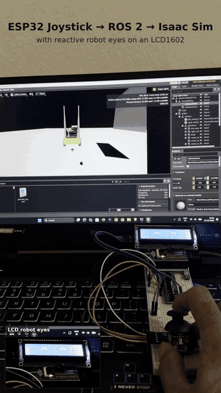
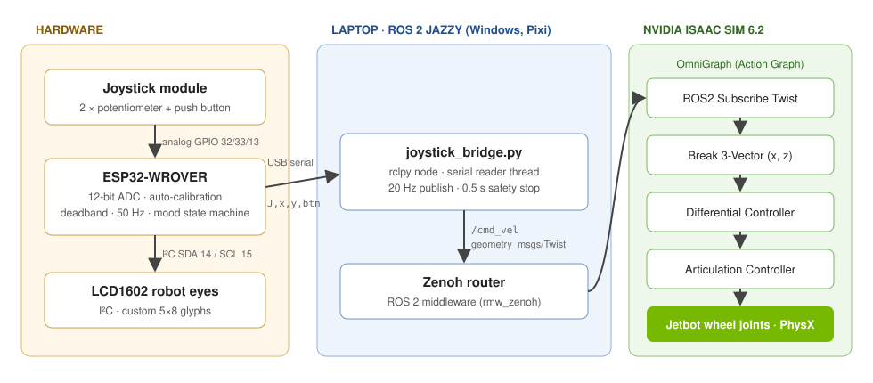

# ESP32 × ROS 2 × NVIDIA Isaac Sim — Hardware-in-the-Loop Teleoperation

A physical joystick on an **ESP32** drives a simulated **Jetbot** in **NVIDIA Isaac Sim 6.2** over **ROS 2 Jazzy** — and an **LCD1602 "robot face"** on the ESP32 reacts to how you drive.

<p align="center">
  
  <br><em>Full-quality video: <a href="media/demo.mp4">media/demo.mp4</a></em>
</p>

## Architecture



| Layer | What it does |
|---|---|
| **ESP32 firmware** (`firmware/`) | Samples the joystick at 50 Hz (12-bit ADC, 8-sample averaging), auto-calibrates the center at boot, applies an 8 % deadband, normalizes to −1…+1 and streams `J,x,y,btn` over USB serial. Drives the LCD eyes with a small mood state machine. |
| **ROS 2 bridge** (`ros2/joystick_bridge.py`) | `rclpy` node: a background thread parses serial lines, a 20 Hz timer publishes `geometry_msgs/Twist` on `/cmd_vel`. Stops the robot if no data arrives for 0.5 s and on shutdown. |
| **Middleware** | ROS 2 Jazzy on native Windows via Pixi, using **Zenoh** (`rmw_zenoh`) as the RMW. |
| **Isaac Sim** (`isaac_sim/`) | OmniGraph Action Graph: *ROS2 Subscribe Twist → Break 3-Vector → Differential Controller → Articulation Controller* drives the Jetbot's wheel joints in PhysX. |

### Differential-drive kinematics
The Differential Controller turns the commanded linear velocity *v* and angular velocity *ω* into wheel speeds:

```
ω_left  = (v − ω·L/2) / r
ω_right = (v + ω·L/2) / r          Jetbot: r = 0.03 m, L = 0.1125 m
```

## Robot eyes (LCD1602)

The HD44780 controller only stores **8 custom 5×8 characters**, so each eye is built from 2×2 custom glyphs and every mood swaps in its own glyph set. Redraws happen only on state changes (I²C at 400 kHz) so the joystick loop stays at 50 Hz.

| Situation | Eyes |
|---|---|
| Driving | normal, random blinks every 2–5 s, gaze follows steering |
| Turbo button held | angry / determined (bridge doubles the speed) |
| Idle > 8 s | tired (half-closed) |
| Idle > 20 s | asleep, with a `z` |
| Woken up | happy `^ ^` for 1.5 s |

The ESP32 also accepts `M,<MOOD>,<ms>` over serial (e.g. `M,HAPPY,2000`) so ROS events can set the mood later.

## Hardware

| Part | Notes |
|---|---|
| Freenove ESP32-WROVER (camera board) | camera can stay attached — pins below are free |
| Joystick module | VRX → GPIO 32, VRY → GPIO 33, SW → GPIO 13, +5V pin → **3.3 V**, GND |
| LCD1602 with I²C backpack (PCF8574) | SDA → GPIO 14, SCL → GPIO 15, VCC → 5 V, GND |
| USB cable | serial link to the PC |

## Software setup (Windows 11)

1. **Isaac Sim 6.2.0** standalone, extracted to `C:\isaacsim`.
2. **ROS 2 Jazzy via Pixi** using NVIDIA's workspace:
   ```bat
   git clone --branch IsaacSim-6.2.0 --recurse-submodules https://github.com/isaac-sim/IsaacSim-ros_workspaces.git C:\IsaacSim-ros_workspaces
   cd /d C:\IsaacSim-ros_workspaces\jazzy_ws
   pixi install
   pixi run build
   pixi add pyserial
   ```
3. **Firmware:** Arduino IDE → board *ESP32 Wrover Module*, library *LiquidCrystal I2C* (Frank de Brabander), upload `firmware/esp32_joystick_eyes/esp32_joystick_eyes.ino`. Keep the stick untouched for ~1 s after reset (calibration).
4. **Isaac Sim scene:** see [`isaac_sim/README.md`](isaac_sim/README.md) for the Jetbot + ROS 2 graph setup.

## Run

Three terminals, each in `C:\IsaacSim-ros_workspaces\jazzy_ws`:

```bat
pixi run zenoh                                         :: 1. ROS 2 middleware router (start first)
pixi run sim                                           :: 2. Isaac Sim with ROS 2 bridge → open scene → Play
pixi run python joystick_bridge.py --port COM21        :: 3. the bridge (copy ros2/joystick_bridge.py here)
```

Options: `--invert-x`, `--invert-y`, `--max-lin 0.3` (m/s), `--max-ang 2.0` (rad/s). Hold the joystick button for turbo (2×).

Test without hardware:
```bat
pixi run ros2 topic pub /cmd_vel geometry_msgs/msg/Twist "{linear: {x: 0.2}, angular: {z: 0.5}}"
```

## Design notes & lessons learned

- **Serial bridge instead of micro-ROS:** on this Windows/Zenoh setup a micro-ROS agent would add another middleware layer; a plain serial protocol is simpler, robust and easy to debug in a serial monitor.
- **Fail-safe:** zero velocity on data loss (0.5 s) and on node shutdown — the same idea as a watchdog on a real robot.
- **The Zenoh router must run** before any ROS 2 node, otherwise nodes can't discover each other.
- **Don't modify the Pixi environment** (`pixi add`) while `pixi run sim` is using it — it crashed Isaac Sim.
- **Only one program can open a COM port** — close the Arduino Serial Monitor before starting the bridge.
- Runs on a laptop **RTX 3060 (6 GB VRAM) with 16 GB RAM**, below Isaac Sim's recommended spec → small scenes, close other apps.

## Roadmap

- [x] Jetbot driven over ROS 2 `/cmd_vel` (keyboard teleop)
- [x] ESP32 joystick → serial → ROS 2 → Isaac Sim
- [x] Reactive LCD robot eyes
- [ ] Robot-arm (Franka) teleoperation with the same joystick (joint modes, later Cartesian via RMPflow)
- [ ] Odometry + TF → RViz
- [ ] Jetbot camera → `/camera/image_raw`
- [ ] Synthetic data with Replicator → YOLO → test on the real ESP32 camera (sim-to-real)

## Author

**Venkatesh Vishal Patil** — M.Sc. AI & Robotics, Hochschule Hof

## License

MIT — see [LICENSE](LICENSE). Isaac Sim is NVIDIA software under its own license; the Jetbot asset ships with Isaac Sim.
